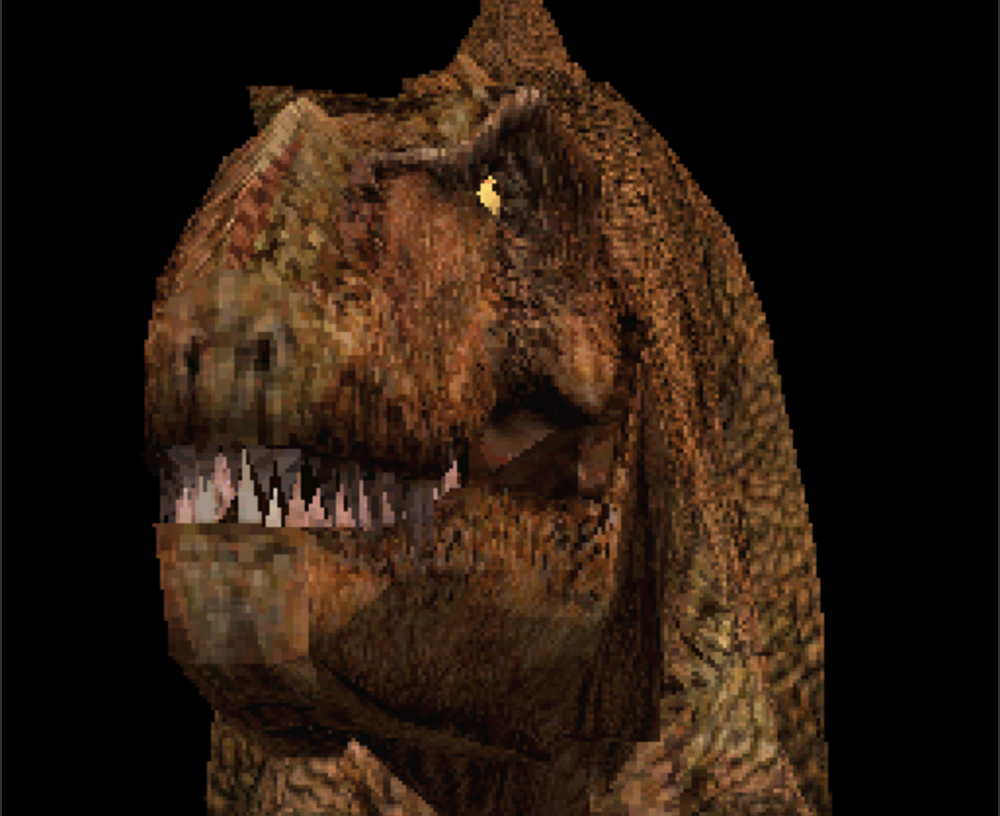
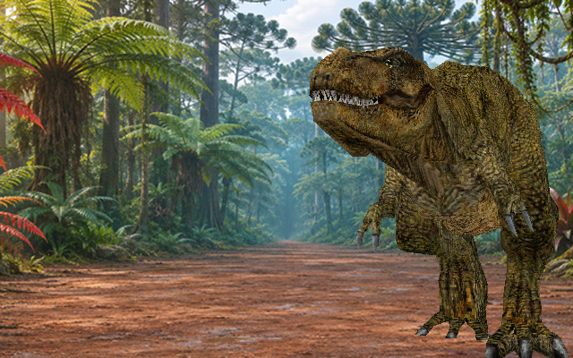

# F030TREX

An Atari Falcon030 port (16 MHz, DSP56001) of the T-Rex renderer from PS1
Demo One (SCES-00048): a DSP56001 geometry/triangle-setup core paired with
an M68030 software rasterizer, targeting a 240x224 render surface inside a
256x224 Videl mode.

## Download

Prebuilt release archives are on the
[releases page](https://github.com/AnimaInCorpore/F030TREX/releases):
`TREX.ZIP` contains `TREX.TOS`, `TREX.LOD` and the 40-column `README.TXT`,
ready to unpack and run on a stock Falcon030 or under Hatari.  The current
release is
[v1.3](https://github.com/AnimaInCorpore/F030TREX/releases/tag/v1.3) --
the draw-order pipeline with the DSP span-and-offset stream over SSI/DMA
(OPTIMIZATION.md 7.4h). On the same corrected Hatari it measures
353.1 ms / 2.83 FPS on the MMU ledger against v1.2's 510.3 ms / 1.96 FPS, and
366.8 ms / 2.73 FPS cycle-exact with Videl contention against v1.2's
681.8 ms / 1.47 FPS. It locks the Falcon
sound system while it runs; no physical Falcon has run it yet.

## Building

Requirements: `node`, a C compiler/`make` for vasm and vlink
(built from the bundled tarballs), and optionally DOSBox to rebuild the DSP
program.

`TREX/dsp/trex_dsp.lod` is checked in prebuilt; `make trex_release` needs no
DOSBox for it. Rebuilding the DSP program after a change to `trex_dsp.asm`
does:

```sh
make DOSBOX=/Applications/dosbox.app/Contents/MacOS/DOSBox trex_dsp
```

The full-mesh release package is built with:

```sh
make trex_release
```

This produces `TREX/m68030/TREX.TOS`: the full 2,724-triangle model with
textured Gouraud lighting and no per-frame diagnostic file writes. It is the
span-stream pipeline (`OPTIMIZATION.md` 7.4h), linked with the four-track
SSI/DMA route, so it locks the Falcon sound system while it runs. The DSP
occlusion prepass is not in it; it survives only in the legacy build. Its
matching `TREX.LOD` is copied beside it for deployment, and
`TREX/m68030/README.TXT` is the 40-column, CRLF release note that ships with
them; those three files together are the release archive.

The release also draws a frame-rate readout in the top-left corner: white
`NN.NN` frames per second, fixed width so the digits never shift column.  It is
built from `-DTREX_FPS` and is on the release target only -- it writes into the
framebuffer, so the diagnostic and capture binaries deliberately omit it (see
OPTIMIZATION.md 2.6).

Run the release on a Falcon or under Hatari from the directory containing the
two files. For TOS 4.02 under Hatari:

```sh
hatari --machine falcon --tos /path/to/tos402.rom --dsp emu --memsize 4 \
  TREX.TOS
```

Use TOS 4.02, 4 MB of ST-RAM and DSP emulation enabled.

**For timing work, use the corrected Hatari, not a stock one.** Stock Hatari
(including the 2.6.1 Homebrew release) grants the Falcon DSP four clocks per
emulated 68030 clock instead of two, so the DSP56001 runs at 32 MIPS against
the real 16. The build vendored in the sibling `F030Arcade` checkout at
`third_party/hatari` fixes that and recalibrates the CPU-to-DSP host port
against DSPBench's real-Falcon figures. On this program the difference is 84.5
ms per frame — 449.7 ms / 2.22 FPS becomes 534.2 ms / 1.87 FPS, all of it in
the DSP readback and packet-build stage, with byte-identical output.
`make measure` runs the documented headless timing recipe against that build
and prints the stage report; OPTIMIZATION.md 2.4g has the measurement, the
mechanism and what it changes. Stock Hatari remains fine for simply watching
the program run. **TOS 4.04 is not
compatible with the current DSP load path**: the program reaches its
video-mode setup, but the DSP remains closed and no triangle packets are
produced. The T-Rex stays absent, although the release-only FPS field can
still update on the black framebuffer. That is a TOS/DSP startup issue, not a
rasterizer failure.

To run the current SSI feed test on a real Falcon, build
`make trex_ssi_loopback` and copy `TREXSSI.TOS` and `TREXSSI.LOD` together to
an otherwise empty directory. This binary executes the validated full-row
stream consumer and feeds the existing rasterizer on the M68030. It is safe
to run on hardware, but it is still a software loopback: it does not enable
the Falcon SSI, Crossbar or record-DMA registers. The run writes the frame-0
diagnostic sidecars (`ssi_rows.res`, `ssi_rows.pkt`, `ssi_rows.status` and
`ssihatri.sta`) so the transport and feed verdict can be copied back for
inspection; later frames use the normal CPU path.

`make ssi_dma_package` builds the Falcon-testable form of that probe:
`TREXDMA.ZIP`, holding `TREXDMA.TOS`, `TREXDMA.LOD` and a 40-column
`README.TXT` that says what the test does to the machine and which files to
send back. **Its DSP image is not interchangeable with the release's**:
`CMD_SSI_STREAM` is assembled only with `SSIPROBE=1`, and any other image
decodes the command as a DSP reset, so the binary loads `TREXDMA.LOD` and
`tools/check_ssi_dma_package.py` refuses to package a mismatched pair. The
packaged files were run from their own directory under the corrected Hatari
and reproduce 7.4b's byte-exact 16,304-word transfer; a deliberately
mis-paired build reports `0 bytes moved` within its 400-tick bound and does
not hang.  The packaged binary also has `stats_flush_enabled` patched to 0 --
the development default rewrites `render_stats.res` after every frame, which
is free under Hatari and a real disk access on a Falcon; it is a data
longword, so the patch is layout-identical to the validated build, and the
file is still written once on a clean keypress exit.

`make trex_m68030_ssi_dma` builds the one target that really does claim the
sound channel and start the Falcon record engine. It routes DSP transmit to
DMA record, has the DSP transmit one framed 16,304-word burst over the SSI,
waits for the declared end address, invalidates the 68030 data cache and
compares the capture against a frame the host built beforehand -- then hands
the channel back and renders normally. It writes `ssi_dma.res` (the
stage-by-stage verdict plus every raw register image it saw) and
`ssi_dcap.res` (the capture); `make ssi_dma_verify` re-derives the payload
and CRC independently. Under the corrected Hatari the transfer arrives
byte-exact. **Its 245 KB/s is the emulator's structural rate, not the
Falcon's specified 1 MB/s**, and the cache contract is untested on real
silicon -- see OPTIMIZATION.md 7.4b before quoting either.

### Hatari capture



## Required reading

[AGENTS.md](AGENTS.md) and [OPTIMIZATION.md](OPTIMIZATION.md) are part of the
implementation, not optional notes: architecture, protocol formats, memory
budgets and every performance-relevant change are documented there and must
stay that way. [TREX/dsp/README.md](TREX/dsp/README.md) describes the DSP
core, its host protocol and its memory budget in detail.

Note: OPTIMIZATION.md is a running measurement log and occasionally names
analysis tooling (for example occlusion-culling or opaque-packet
self-tests) that is not part of this repository's build. Treat those
mentions as the historical record of how a figure was produced, not as
commands you can run here.

## Target and current state

Atari Falcon030, 16 MHz, DSP56001. Render target 240x224 inside a 256x224
Videl mode. The supported release is a single full-mesh package: `TREX.TOS`
uses the 2,724-triangle model and textured Gouraud shading; the DSP occlusion
prepass is no longer part of the release and survives only in the legacy
build; `TREX.LOD` is the matching DSP program. The deprecated reduced-mesh variant
and its build assets have been removed. Performance figures in
OPTIMIZATION.md are identified as Hatari/emulator results.  **The first
physical Falcon030 measurement (2026-09-02) reads 1.05 FPS on the close-up
frames, against the emulator's 2.17 for the same stretch** -- and the
emulated choreography is flat (377-504 ms end to end), so that is a uniform
~2x, not a hard scene.  The renderer itself is correct on hardware.  Section
2.7 has the curve, the two candidate causes that this file named *before* the
run -- Videl stealing the ST-RAM bus, and the host-port PIO loop, neither of
which the emulator charges for -- and the `make prof_package` build that
separates them.  Emulator A/B results are unaffected, since they compare two
builds under the same emulator; the absolute frame times are not Falcon
figures. Figures predating OPTIMIZATION.md 2.4g were taken
with the DSP at twice its real clock and are superseded by the re-measurement
there. **Since 2026-11-18 the default is the draw-order pipeline** (OPTIMIZATION.md
4.1f and 4.1g): the DSP sends one depth key per surviving triangle, the 68030
sorts them and names the triangles for the DSP in draw order, and it draws
each batch as it arrives instead of waiting for all of them. At a
byte-identical picture over 512 frames the diagnostic build measures
**540.9 ms / 1.85 FPS** cycle-exact and **363.1 ms / 2.75 FPS** on the MMU
ledger, and `TREX.TOS` **543.1 ms / 1.84 FPS** and **365.1 ms / 2.74 FPS**,
against 599.7 and 425.7 ms for the previous pipeline on the same emulator.
`make trex_m68030_legacy` builds that previous pipeline (`-DTREX_LEGACY_OT`,
`TREXLEGA.LOD`). **Since 7.4h the default also streams spans** (`OPTIMIZATION.md`
7.4g/7.4h): the DSP walks the rows and pixels of most textured triangles and
sends spans and texel offsets over SSI/DMA, leaving the 68030 the texel fetch
and the framebuffer write. At an identical picture over 512 frames the
diagnostic build measures **365.3 ms / 2.74 FPS** cycle-exact and
**351.8 ms / 2.84 FPS** on the MMU ledger, and `TREX.TOS` **366.8 ms /
2.73 FPS** and **353.1 ms / 2.83 FPS**; the draw-order figures above are now
the plain pair's, `make trex_m68030_plain` (`-DTREX_PLAIN_ORDER`,
`TREXORDR.LOD`). The default claims the sound system (`Locksnd`, DSP transmit
to DMA record) while it runs and falls back to the plain pipeline if it cannot.
**Since 2.8a (unreleased)** the host assembles the next batch's list ahead
of the hand-over and services the DSP during the framebuffer clear, at an
identical picture: the diagnostic build measures **348.5 ms / 2.87 FPS**
cycle-exact and **339.2 ms / 2.95 FPS** on the MMU ledger, and `TREX.TOS`
**349.0 ms / 2.87 FPS** and **339.3 ms / 2.95 FPS**. Since 2026-11-21
(OPTIMIZATION.md 2.8c and 2.8e) shorter DSP per-triangle code brings the
cycle-exact diagnostic build to **317.9 ms / 3.15 FPS** and the dinosaur
trail to **323.4 ms / 3.09 FPS**, with identical frames; the other figures
here have not been re-measured.
Since 2026-11-23 (OPTIMIZATION.md 2.8f) the DSP streams every qualified
triangle. That is the balance on the Hatari fork's new Falcon bus model, which
charges the 68030 its measured ST-RAM and Videl costs. On that emulator the
diagnostic build goes from 426.9 to **354.3 ms / 2.82 FPS** and the dinosaur
trail from 512.3 to **391.8 ms / 2.55 FPS**, with identical frames. These
figures are not comparable with the ones above, which were taken on the
older emulator.
Emulator only; no Falcon has run the stream yet.

The **dinosaur trail** is a fixed-camera, 640×400 live 3D scene from a
standing human's eye height.
The T-Rex walks in on the camera's left, eases into a turn over one and a
half strides and then circles a 5.8 m patrol, six strides to the lap. The tail
sways with the steps and trails through the turn. The walk itself leaves the
head alone: in the viewing build the Falcon makes it glance left and right,
bare its teeth and open its mouth at random, so no two laps look alike.
The clay trail recedes toward the middle of the jungle at the camera's eye
level. Tall tree ferns, coral fronds and turquoise moss line its edges.
The full 2,724-triangle model and its six native texture pages are lit by the
canopy opening and reflected light from the bare earth. See the
[performance reference](OPTIMIZATION.md#66i-wider-lap-secondary-motion-and-random-gestures) for
the current Hatari measurements.

Build it with `make trex_m68030_hires_backdrop_run`. Run `trex_hires_bg_run.tos`
beside `TREXBGND.LOD` on a Falcon with 14 MiB ST-RAM and an RGB/TV display.
The packaged executable is named `TRAIL.TOS`. Watch the
[approach and three laps as rendered by Blender](docs/previews/trex-wide-lap.mp4)
(the walk only), and a
[Hatari capture with the random head gestures](docs/previews/trex-gestures-hatari.mp4).



**The Blender scene is the source of the trail.** [`TREX/scene/trex_trail.blend`](TREX/scene/trex_trail.blend)
holds the camera and lens, the T-Rex path, one pose shape key per displayed
frame, the ground shadow, the camera-fixed lights, the shade ramp and the
backdrop. Its material reproduces the DSP's lighting and the host's 5-bit
colour arithmetic, and EEVEE renders it with the Raw view transform, so a
Blender frame is the reference for the Falcon frame. `make backdrop` exports
every trail asset from it (Blender 5.3 on PATH; under MSYS2 install
`mingw-w64-ucrt-x86_64-blender`, on macOS `brew install --cask blender`).
`make blender_seed` regenerates the scene itself from the route generator and
adds the tail motion. Shape keys named `DSP random <group> …` are gestures
the 68030 triggers at run time, up to the key's slider maximum; keep the
baked head and neck unturned, because the gestures are deltas for that pose.
`make backdrop` needs no Pillow; `make model_export` does, and
`make blender_pillow` installs it where Blender's own Python finds it. The exporter bakes all deformation into
per-frame XYZ16 poses, except shape keys named `DSP …`, which it sends as the
DSP's own morph targets with per-frame Q12 weights. The mesh, UVs, texture
pages and corner normals stay the TMD's; the exporter refuses a scene that
changed them. See [OPTIMIZATION.md 6.6g](OPTIMIZATION.md#66g-the-blender-scene-is-the-source)
for the pipeline, its checks and the cost of DSP targets.

**Other models.** `tools/blender_export_model.py` turns any Blender mesh
into a model directory with the same file formats as the T-Rex: a TMD, an
OBJ, six 8-bit texture pages, and the mesh sizes for the host and the DSP.
It checks the model against the DSP's memory, about 1,400–1,700 vertices
depending on the normals. `make MODEL_DIR=<dir> trex_m68030_hires_backdrop_run`
then builds that model's trail scene. Start from a copy of
`trex_trail.blend`, swap in the model and animate it, then run
`make model_export BLEND=<file> MODEL_OBJECT=<name> MODEL_DIR=<dir>`.
See [OPTIMIZATION.md 6.6h](OPTIMIZATION.md#66h-any-blender-model-as-a-model-directory).
See the [mesh tool and conversion guide](docs/asset-conversion.md) for Battlefront extraction, retopology, texture baking and the Windows launch paths.
A scene rendered at 256x224 instead of 640x400 builds the same trail in the
default build's lo-res true-colour mode (RGB/TV and VGA): export it with
`MODEL_BACKDROP=backdrop_256x224.bin`, then
`make MODEL_DIR=<dir> trex_m68030_lores_backdrop_run`. Its pixels are about
1.18 times as wide as tall, so set the scene lens and pixel aspect
accordingly. See [OPTIMIZATION.md 6.6l](OPTIMIZATION.md#66l-the-backdrop-trail-at-256x224-trex_lores-2026-11-26).

**AT-AT glacier patrol.** Open the [packed Blender scene](TREX/scene/atat_patrol.blend)
or [watch the 50-frame Hatari capture at 8 fps](docs/previews/atat-patrol.mp4).
One walker tracks a target and fires twice. Its rig and armour come from
`assets/Tutorial.blend`. The [mesh comparison](docs/previews/atat-mesh-comparison.png)
shows the original and the earlier 1,648-vertex, 2,810-triangle reduction under
the same lighting; the capture and comparison predate the current body. The
walker's body is now a LATO.2 remesh, mirrored for symmetry, with its holes
closed and its hidden inner faces removed: 1,535 vertices and 2,540
triangles, at 524.9 ms/frame in cycle-exact Hatari with Videl contention
(Hatari `b2d65b04…`; 500.2 ms with the earlier hull body on the same build). To
rebuild the packed scene and the individual rigged mesh, run
`make atat_scene` with the supplied asset and `blender/atat/lato/body_lato.obj`
present.
For Falcon export and the earlier column shot, see
[OPTIMIZATION.md 6.6j](OPTIMIZATION.md#66j-two-walkers-on-a-snowfield-one-model-several-actors-2026-11-20).

The figures in the rest of
this paragraph are the previous pipeline's. Over the 265-frame prefix its full-mesh **diagnostic** build
measured **433.7 ms / 2.31 FPS**, and `TREX.TOS` measures **431.1 ms /
2.32 FPS** with its release-only overlay and default-disarmed prepass
(2026-09-06, OPTIMIZATION.md 2.4m). The prelight pass now retains its exact
visibility verdict while the CPU rasterizes the previous frame. BUILD skips
rejected triangles before index/vertex fetch and reuses the screen-box verdict,
saving 25.9 ms per frame (about 6% more FPS) without changing the host binary,
wire format, memory allocation or DSP program size. Both disarmed and armed
occlusion runs preserve all 483 choreography-plus-hold frame hashes.
The frame-local normal-light cache removes 7.6 ms from the diagnostic
DSP/packet path (section 2.4i), section 8.2b's direct-to-packet record unpack
removes another 24.9 ms of the packet stage at byte-identical output, 2.4j's
object-space lighting a further 2.1 ms at whole-choreography pixel identity,
and 2.4k's frame-ahead lighting -- every survivor lit inside the FINISH window
over a two-word packed normal table, BUILD reading one word per survivor --
38.6 ms more at byte-identical output over all 483 hashed frames; each section
carries its fixed-prefix gates. Section 2.4l put a per-phase timer on the
exposed DSP work **before 2.4m's cached cull**: of 130.4 ms over the whole
mesh, **span setup is 70.1 ms**, the backface classify 22.3, the chunk loop
and index unpack 13.3, the record pack 11.2, the bounding box 6.3, the sort
key 5.1 and the prelight fetch 2.1 -- 128.1 ms once the ladder's own guards
(~2 ms, measured by its control arm) are taken out.  `make_triangle_span` is
the largest measured item left inside BUILD.

The v1.3 release measures **353.1 ms per frame, 2.83 FPS** on the MMU
ledger and **366.8 ms / 2.73 FPS** cycle-exact with Videl contention, under a
Hatari corrected to run the DSP at the Falcon's real clock (OPTIMIZATION.md
7.4h). The published v1.2, timed on the same emulator binary, measures
510.3 ms / 1.96 FPS and 681.8 ms / 1.47 FPS (2.4e had 511.2 ms). Older figures in that file were taken on a stock
emulator that ran the DSP at twice its rate and are ~24% optimistic on the
whole frame; sections 2.4b--2.4j are the corrected ones. Still not a Falcon
measurement.

The DSP program is the post-harvest build of OPTIMIZATION.md section 2.3h --
nine sites reworked for size and speed at byte-identical output, with the
armed occlusion prepass measured 25.6% cheaper in Hatari -- plus 2.4i's
128-entry normal-light cache, which lets repeated corner normals bypass their
3x3 rotation and six direct-light dot products while retaining the
per-triangle depth cue, and object-space lighting: the six light vectors
rotate through the frame-matrix transpose once per frame and the Lambert loops
dot the raw corner normal, measured pixel-identical over a 321-frame
whole-choreography hash sweep, and 2.4k's prelight pass: the corner-normal
table is packed two words per normal, the 3,610 words that frees hold one
lighting word per triangle, and the FINISH window -- otherwise idle DSP time
while the 68030 rasterizes -- lights every survivor of the frame ahead of
BUILD, which reads the table instead of computing.

The default image (`ORDERED=1 SPANSTREAM=1`) is the draw-order image with the
span walker of section 7.4g; it omits the occlusion sweep and ends at
`P:$0975`, 74 words below the resident-index ceiling, and its camera-lights
A/B reference (`make trex_dsp_camlights`) ends at `P:$0962`. The plain
draw-order image (`SPANSTREAM=0`, `make trex_m68030_plain`) ends at `P:$07EF`.
The legacy index-order image (`ORDERED=0`, `make trex_dsp_legacy`) ends at
`P:$099E`, and the extents quoted for the probe variants below are those of
that image, on which they are built. Besides
`ORDERED` and `SPANSTREAM`, seven switches in the generated
`dspconf.inc` select what is assembled, because in the legacy image it does
not all fit: the `CMD_SSI_STREAM` transport probe
of section 7.4b (`SSIPROBE`, 103 words), the prelight pass (`PRELIGHT`, 66),
the cross-frame window burn loop (`WINPROBE`, 44), section 2.3j's prepass
diagnostic counters (`PREPASSDIAG`, 30), the host-port calibration burst
(`PIOBURST`, 25), section 2.4l's per-phase BUILD timing ladder
(`PHASEPROBE`, 21) and object-space lighting (`OBJLIGHTS`, 19). The shipping
and measurement builds take object-space lighting and the prelight pass; the
window probe and the counters each re-assemble only beside `OBJLIGHTS=0`
(`WINPROBE=1 OBJLIGHTS=0` ends exactly at `P:$09BF`); the SSI transport
bring-up build trades everything but the probe and ends at `P:$09B8` with 7
words to spare. `PHASEPROBE` is the only one that fits beside the shipping
configuration unchanged (`P:$09BB`, 4 words free), which is what lets its
ladder time the BUILD body the release actually runs -- `make measure_phase`
and `make measure_phase_control`, decoded by
`tools/decode_phase_stats.py`.

## Feature comparison with the PS1 reference

The port preserves the source model and animation data, but its execution
pipeline is deliberately Falcon-specific. This table describes the current
release rather than claiming pixel-for-pixel equivalence with the PS1 demo.

| Feature | PS1 reference | Falcon port (`TREX.TOS`) |
| --- | --- | --- |
| Mesh | Original TMD model | Same full mesh: 1,376 vertices and 2,724 triangles |
| Animation | Authored morph-target choreography | Extracted PS1 morph data rebuilt on the DSP: 46 full gait poses plus sparse targets 5–8; the port adds a post-source hold after frame 273 |
| Transform and culling | Original console geometry pipeline | DSP56001 handles transform, perspective projection, near-plane, degenerate-area, back-face and screen culling |
| Occlusion | Reference-scene behavior | None in the release. A DSP screen-space prepass that builds a conservative triangle kill bitmap survives in the legacy build for yield work; it measured as a net loss |
| Lighting | Original PS1 lighting | Textured Gouraud shading with three coloured lights and reddish ambient light; documented as not yet an exact PS1 lighting reproduction |
| Textures | PS1 TIM pages and CLUT metadata | Extracted PS1 texture pages and CLUTs, sampled by the M68030 software rasterizer |
| Rasterization | PS1 hardware GPU path | M68030 software rasterizer; the DSP supplies depth keys and span setup; the host sorts the keys with its Ordering Table rule, names the triangles for the DSP in draw order and draws each batch as it arrives |
| Display | Original PS1 display mode | 240×224 render surface inside a 256×224 Falcon Videl mode |

The release therefore matches the PS1 source data most closely in geometry,
animation and texture assets, while transform, occlusion, lighting and
rasterization are the Falcon implementation.

## Credits

The PlayStation forensics -- working out the TMD model, the TANM morph
animation and the TIM texture pages from the source disc -- the whole M68030
front end and most of the DSP56001 program were written by AI: ChatGPT 5.6,
Claude Opus 5 and Claude Fable 5.

Sascha Springer's share is the direction, a number of the ideas, and the two
innermost routines of the DSP core, both carried over from the Falcon DSP 3D
engine he wrote in 1994: `transform_vertices` is the MAC pipeline of that
engine's `rotate_translate`, unchanged apart from three added `rnd`
instructions and new symbol names, and the signed perspective divide is the
same 1994 `rep #24` / `div` sequence. They run per vertex and per visible
triangle, so the oldest code in the repository is also the hottest.
Everything beyond that is the AI's work.

Model, animation and textures are extracted from Sony's PlayStation *Demo
One* (SCES-00048). The 256x224 Videl register sets are Screenspain's
(Chris/AURA and Scandion/Mugwumps), carried over from the F030Arcade snowbros
port -- see the video-mode comment in `TREX/m68030/trex_m68030.s`. This is a
non-commercial hobby port; the original PS1 assets belong to their owners.

**Three.js glacier patrol.** The [Afterglow build recipe](three-patrol/README.md) combines the Battlefront 2015 walker and its original walk clip in an offline browser player and a matching Falcon scene.
